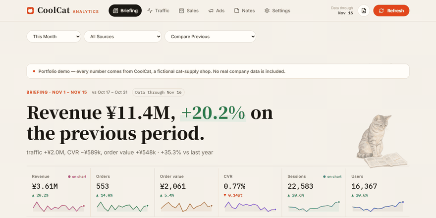
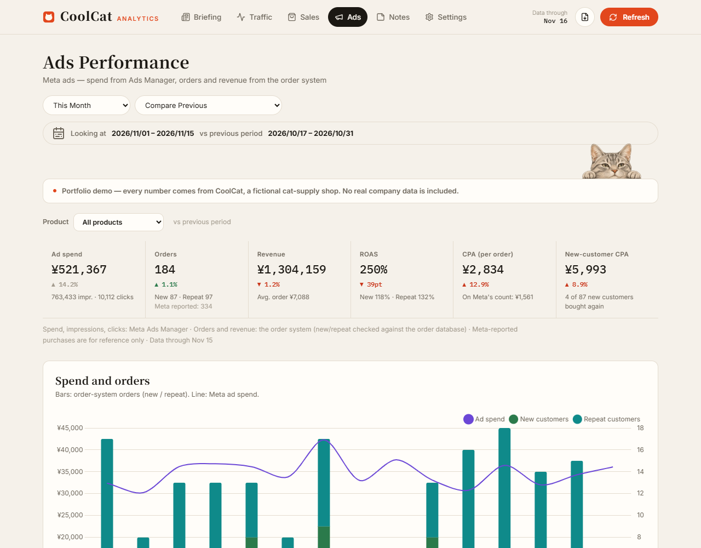
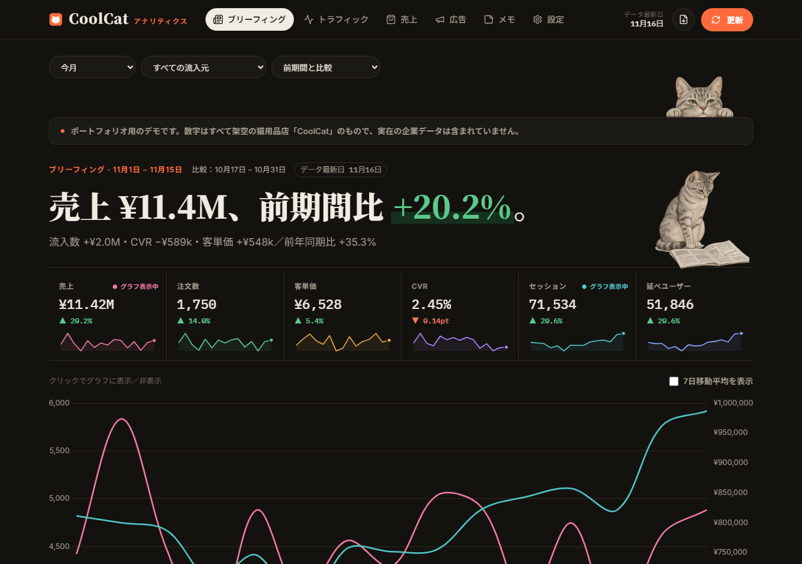
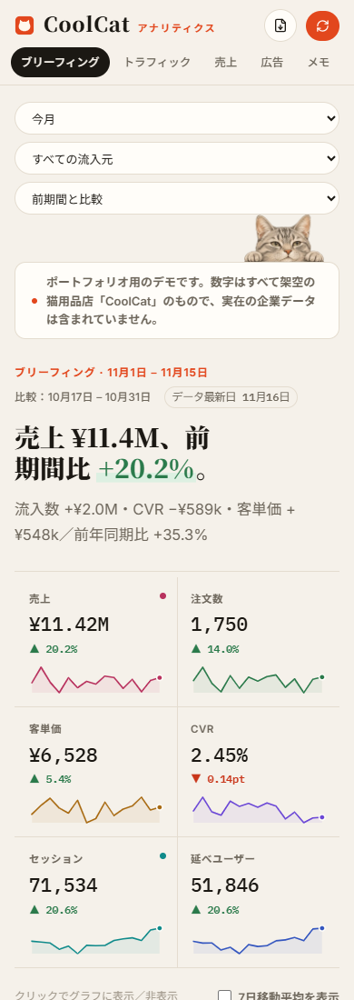

# CoolCat Analytics Dashboard

### Did revenue move this week, and why?

An e-commerce marketing dashboard built for the team at my workplace, rebuilt here around a fictional cat-supply shop. It pulls five separate data exports into one bilingual (日本語 / English) page and, instead of leaving you to squint at charts, **writes out what changed and why** in plain sentences.

**[▶ Open the live demo](https://coolcatplayground.github.io/marketing-dashboard/)** — every number comes from a generated demo store, and a note at the top of the page says so.

---

## Field notes: the creature in the wild

The weekly marketing review ran on exports that didn't talk to each other: daily GA4 totals, traffic by source, landing-page traffic, a new-versus-repeat customer spreadsheet, and, more recently, Meta ad spend. Answering "did revenue move, and why?" meant opening all of them, lining them up by hand across mismatched date formats, and rebuilding the same pivot table every single week.

The numbers were all there. The *reading* of them was the work, and it started from zero every time. This dashboard does that reading once, the same way every time, so the meeting starts from a written conclusion people can argue with instead of a blank pivot table.

## A tour of the rooms

**Briefing.** The page opens on one sentence: *"Revenue ¥11.4M, +20.2% on the previous period."* Underneath sits the decomposition: how much of the change came from traffic, how much from conversion rate, and how much from order value. Then come six vital signs with sparklines (click one to put it on the chart), and **What changed**: short stories ranked by how much they need attention, from unusual days and rising pages to the driver behind the revenue change. Each one opens onto the numbers behind it.

- **Compare against the previous period or the same dates last year.** Handy when a month is naturally busy, so this December is judged against last December rather than November.

**Traffic.** Where visitors came from this period versus last, grouped by platform → campaign type → referrer. Click a channel to filter everything to it and see its trend. The landing-page list covers the last 30 days, splits PC from smartphone, can hide system pages (cart, login and so on) that inflate the counts, and flags any page **spiking today or yesterday** against its usual day.

**Sales.** Performance by business month, average order value split into overall / new / repeat, and new-versus-repeat customers with the new-customer share over time.

**Ads.** Meta ad spend lined up against the orders the shop's *own* order system confirms, split into new and repeat customers. You get ROAS, cost per order and cost per *new* customer, and how many of those new customers have come back since. The table goes campaign by campaign, with a product filter.

**Notes.** A shared team notebook for writing down what actually happened ("magazine feature went out", "site was down Tuesday"). The public demo has no database behind it, so a cat sleeps here instead.

**Everywhere.** Full 日本語 / English switching, dark theme, CSV export, and a print layout for PDF.

| | |
|---|---|
|  |  |

## The demo store

Random numbers make a dashboard look broken: a flat order value, revenue swinging at random, insights about nothing. So the demo runs on one small model of a shop, [`js/demo-data.js`](js/demo-data.js), and all five feeds are cut from it. Traffic sources add up to the daily totals, landing pages add up to their sources, Meta's ad clicks *are* the Meta sessions, and the monthly customer sheet is the daily orders summed by business month. [The tests](tests/demo-data.test.js) check that the feeds keep agreeing, and they run on every push.

It is keyed to the calendar, not to `Math.random`, so the same day shows the same numbers on every load, and it always ends today. What it's built to show:

- a week with a rhythm: LINE broadcasts on Tuesdays, the newsletter on Thursdays, Sunday-evening shopping
- a year: 猫の日 in February, summer cooling goods, Black Friday, the December gift peak, then January's 初売り and the lull after it
- search slowly shifting from Yahoo! toward Instagram and AI assistants
- Meta ads switched on four months ago, with Meta crediting itself with far more purchases than the order system confirms
- this week, an Instagram reel about a cat kotatsu (a heated cat bed): plenty of sessions on one page, very few orders
- today, a LINE broadcast pushing matatabi sticks

## The cats

A dashboard is usually opened when someone is a little worried about a number, so this one tries to lower the temperature without getting in the way. Four illustrations, painted with Codex in an ink-and-wash editorial style, sit on edges the page already has:

- a cat reads the paper on the briefing's bottom rule
- a cat peeks over the demo note
- a cat sleeps wherever a feature is switched off
- a cat strolls along the header when you arrive and when you press Refresh

Figures count up to their new value instead of jumping, and cards settle in when a tab opens. All of it lives in two files ([`js/coolcat.js`](js/coolcat.js), [`css/coolcat.css`](css/coolcat.css)), changes no number, and switches off under *reduce motion*.

## House rules

- **Some charts are deliberately missing.** GA4 credits a sale to the page where the visit *started*, so a visitor whose session resets mid-checkout gets credited to the order-confirmation page. Revenue per landing page would be a confidently wrong number, so the dashboard shows only sessions per page, which that problem doesn't affect.
- **Ad platforms don't grade their own homework.** Meta's reported purchases are shown, but labelled "for reference". ROAS and cost per order are computed from orders the shop's own system confirms.
- **"No data" never pretends to be "no change."** If the comparison period falls outside the available data (easy to do with same-period-last-year), the percentages say "N/A", the range bar shows a warning, and the insights skip every sentence that depends on the comparison. A silent "0.0%" would have been a lie.
- **Demo data announces itself.** Each feed falls back to demo data on its own, and a banner names exactly which sections are showing it. A feed that is connected but fails to load shows as unavailable, never as made-up numbers. A dashboard that quietly shows invented figures is worse than one that refuses to load.
- **The month follows the business, not the calendar.** Monthly figures run from the 21st to the 20th, because that's the boundary the company's financial reporting already uses.
- **Insights state facts, not orders.** The sentences report what changed. They stop short of "you should…", because the dashboard doesn't know the commercial context behind the numbers, and pretending it did would undermine the parts it gets right.
- **Switching language never breaks a filter.** Channel names are translated only on screen, so an active filter keeps working when you switch languages mid-session.

## Construction

The questions, the metrics that are worth trusting, and the house rules above came from using this in real weekly reviews. The dashboard itself was built with generative AI under my direction.

Plain HTML, CSS and JavaScript with Chart.js, PapaParse and Lucide; no build step. Each feed is a published Google Sheet (CSV), set in `js/data.js`. Team notes use Firebase Firestore, configured in `js/notes.js`. Left empty, as they are here, the feeds fall back to the demo store and notes stay off.

This public version is generated from the internal one by a script that swaps in the fictional brand and strips the internal build's data connections, sign-in screen and team database. No company data appears anywhere in this repository.
